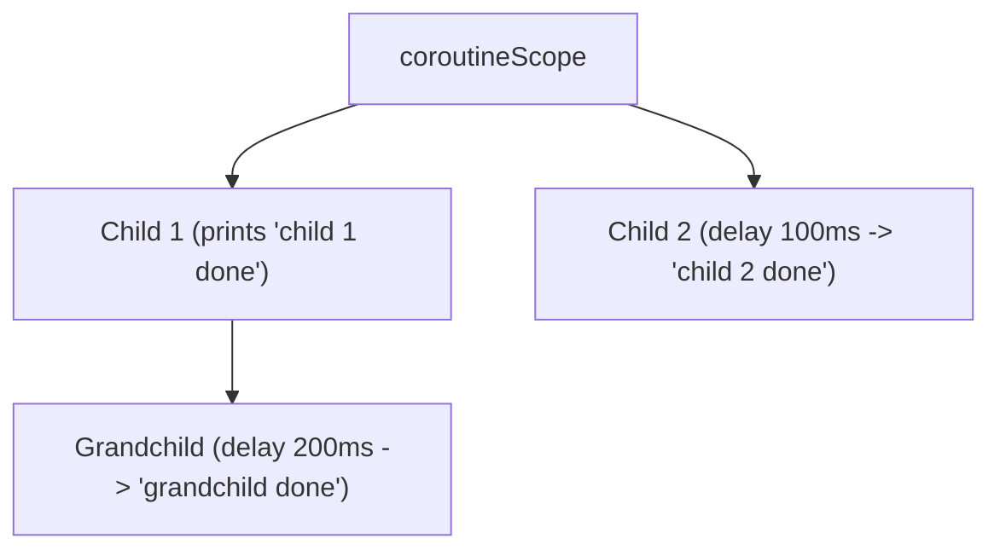

# Kotlin Coroutines Practice Work: Practical Questions

**Date:** 5 Nov 2026  
**Environment:** Kotlin/JVM, `kotlinx-coroutines-core:1.10.2`, Java 19, IntelliJ IDEA  
**Organization:** TTPU Organizations (Turin Polytechnic University in Tashkent)

---

## Table of Contents
1. [Core Concept: Suspending vs. Blocking](#core-concept-suspending-vs-blocking)
2. [Question 1: First coroutine](#question-1-first-coroutine)
3. [Question 2: Three baristas](#question-2-three-baristas)
4. [Question 3: Chain of suspend functions](#question-3-chain-of-suspend-functions)
5. [Question 4: Calling suspend from normal code](#question-4-calling-suspend-from-normal-code)
6. [Question 5: Suspend is not a thread](#question-5-suspend-is-not-a-thread)
7. [Question 6: Ten downloads, one thread](#question-6-ten-downloads-one-thread)
8. [Question 7: Order of launch](#question-7-order-of-launch)
9. [Question 8: Parent waits for child](#question-8-parent-waits-for-child)
10. [Question 9: Screen closed, requests cancelled](#question-9-screen-closed-requests-cancelled)
11. [Question 10: Profile ready](#question-10-profile-ready)
12. [Question 11: Reusable counter](#question-11-reusable-counter)
13. [Question 12: Returns at once or waits](#question-12-returns-at-once-or-waits)
14. [Question 13: Five builders (Cheat Sheet)](#question-13-five-builders-cheat-sheet)
15. [Question 14: Job or Deferred](#question-14-job-or-deferred)
16. [Question 15: Three exports in a scope](#question-15-three-exports-in-a-scope)
17. [Extra 1: Delay or sleep: measure it](#extra-1-delay-or-sleep-measure-it)
18. [Extra 2: Three levels of coroutines](#extra-2-three-levels-of-coroutines)
19. [Extra 3: No scope, no launch](#extra-3-no-scope-no-launch)
20. [Extra 4: What the compiler sees (Decompiled Bytecode)](#extra-4-what-the-compiler-sees)
21. [Extra 5: Greet everybody](#extra-5-greet-everybody)

---

## Core Concept: Suspending vs. Blocking

> **Explanation of how Suspending differs from Blocking:**
> - **Blocking (`Thread.sleep`)**: Blocks the underlying operating system thread completely. While blocked, the thread cannot perform any other computations or run other coroutines assigned to it. It wastes system resources and causes UI freezes if called on the main thread.
> - **Suspending (`delay`)**: Pauses only the specific coroutine without blocking the underlying thread. The thread is released back to the dispatcher's thread pool / event loop to execute other available coroutines. When the suspension finishes, the coroutine is resumed (either on the same thread or another thread depending on the dispatcher).

### Code Demonstration

```kotlin
// Comparison: Suspending vs Blocking
import kotlinx.coroutines.*

fun demonstrateSuspendingVsBlocking() = runBlocking {
    println("--- SUSPENDING (Thread is released) ---")
    // Both coroutines run concurrently on the single main thread:
    launch {
        println("Task 1 suspends with delay (yields thread)")
        delay(200) // Thread is NOT blocked! Task 2 can run immediately.
        println("Task 1 resumed")
    }
    launch {
        println("Task 2 runs while Task 1 is suspended!")
    }

    delay(400) // wait for demo to finish

    println("\n--- BLOCKING (Thread is frozen) ---")
    launch {
        println("Task 3 blocks thread with Thread.sleep")
        Thread.sleep(200) // Entire thread is frozen! Nothing else can execute on it.
        println("Task 3 finished sleep")
    }
    launch {
        println("Task 4 was starved and could only run AFTER Task 3 unblocked the thread!")
    }
}
```

---

## Question 1: First coroutine

### Source Code: `questions/Question01.kt`
```kotlin
package questions

import kotlinx.coroutines.delay
import kotlinx.coroutines.launch
import kotlinx.coroutines.runBlocking

fun runQuestion1() = runBlocking {
    launch {
        delay(1000L)
        println("Coffee ready")
    }
    println("Order accepted")
}

fun main() = runQuestion1()
```

### Program Output
```text
Order accepted
Coffee ready
```

### Explanation
- **Order of lines:**
  1. `Order accepted`
  2. `Coffee ready`
- **Why "Order accepted" comes first:**
  `launch` starts a new concurrent coroutine as a background child of `runBlocking` without blocking the executing thread. It schedules the coroutine block onto the thread's event loop queue. The main body immediately proceeds to execute the next synchronous statement, `println("Order accepted")`. The coroutine inside `launch` then starts and hits `delay(1000L)`, which suspends it for 1 second. After 1 second elapses, the coroutine resumes and prints `"Coffee ready"`.

---

## Question 2: Three baristas

### Source Code: `questions/Question02.kt`
```kotlin
package questions

import kotlinx.coroutines.delay
import kotlinx.coroutines.launch
import kotlinx.coroutines.runBlocking

fun runBaristasWithDelay() = runBlocking {
    println("=== Running with delay (Suspension) ===")
    launch {
        println("Espresso start")
        delay(300L)
        println("Espresso end")
    }
    launch {
        println("Tea start")
        delay(100L)
        println("Tea end")
    }
    launch {
        println("Latte start")
        delay(200L)
        println("Latte end")
    }
}

fun runBaristasWithSleep() = runBlocking {
    println("\n=== Running with Thread.sleep (Blocking) ===")
    launch {
        println("Espresso start")
        Thread.sleep(300L)
        println("Espresso end")
    }
    launch {
        println("Tea start")
        Thread.sleep(100L)
        println("Tea end")
    }
    launch {
        println("Latte start")
        Thread.sleep(200L)
        println("Latte end")
    }
}
```

### Program Output

#### 1. With `delay` (Suspension):
```text
=== Running with delay (Suspension) ===
Espresso start
Tea start
Latte start
Tea end
Latte end
Espresso end
```

#### 2. With `Thread.sleep` (Blocking):
```text
=== Running with Thread.sleep (Blocking) ===
Espresso start
Espresso end
Tea start
Tea end
Latte start
Latte end
```

### Explanation in One Sentence
> **In the suspension case (`delay`), the single thread is released during each pause allowing the other baristas' coroutines to start and interleave concurrently, whereas in the blocking case (`Thread.sleep`), the single thread is monopolized and frozen by the active coroutine, forcing all tasks to execute purely sequentially.**

---

## Question 3: Chain of suspend functions

### Source Code: `questions/Question03.kt`
```kotlin
package questions

import kotlinx.coroutines.delay

suspend fun loadUser() {
    println("Step 1: Loading user...")
    delay(100L)
    checkPassword()
}

suspend fun checkPassword() {
    println("Step 2: Checking password...")
    delay(100L)
    openProfile()
}

suspend fun openProfile() {
    println("Step 3: Opening profile...")
    delay(100L)
    println("Step 3 completed: Profile is open.")
}

suspend fun runQuestion3() {
    println("--- Login flow started ---")
    loadUser()
    println("--- Login flow finished ---")
}

suspend fun main() = runQuestion3()
```

### Program Output
```text
--- Login flow started ---
Step 1: Loading user...
Step 2: Checking password...
Step 3: Opening profile...
Step 3 completed: Profile is open.
--- Login flow finished ---
```

### Explanation
Suspending does not change or reorder code sequence. When a suspend function executes within a coroutine, execution flows strictly sequentially from statement to statement, just like regular synchronous code. A suspension point (`delay`) simply pauses the coroutine until the operation is complete, after which execution resumes at the exact next line without reordering.

---

## Question 4: Calling suspend from normal code

### Source Code: `questions/Question04.kt`
```kotlin
package questions

import kotlinx.coroutines.delay
import kotlinx.coroutines.runBlocking

suspend fun fetchUserData(): String {
    delay(100L)
    return "User: John Doe"
}

// 1. Code that causes compilation error:
/*
fun normalFunctionCompileError() {
    val data = fetchUserData() // ERROR!
    println(data)
}
*/

// Fix 1: Make the caller a suspend function
suspend fun fix1SuspendCaller(): String {
    return fetchUserData()
}

// Fix 2: Bridge using runBlocking
fun fix2UsingRunBlocking(): String {
    return runBlocking {
        fetchUserData()
    }
}
```

### Compile Error Message
```text
Suspend function 'fetchUserData' should be called only from a coroutine or another suspend function
```

### The Two Fixes
1. **Fix 1:** Mark the caller function as `suspend` (e.g., `suspend fun fix1SuspendCaller()`), propagating the suspension capability up the call hierarchy.
2. **Fix 2:** Use a coroutine builder such as `runBlocking { fetchUserData() }` or launch from an existing scope (e.g. `viewModelScope.launch { fetchUserData() }`).

### Which fix you NEVER use on Android UI thread and why:
> **We must NEVER use `runBlocking` on the Android UI (Main) thread.**  
> **Reason:** `runBlocking` blocks the current thread until the coroutine and all of its children finish. Calling it on the Android UI thread halts UI rendering and user event dispatching, freezing the application, dropping frames (jank), and causing an **Application Not Responding (ANR)** crash if blocked for more than 5 seconds.

---

## Question 5: Suspend is not a thread

### Source Code: `questions/Question05.kt`
```kotlin
package questions

import kotlinx.coroutines.runBlocking

suspend fun retrieveCurrentThreadName(): String {
    return Thread.currentThread().name
}

fun runQuestion5() = runBlocking {
    val threadBefore = Thread.currentThread().name
    val threadFromSuspend = retrieveCurrentThreadName()

    println("Thread name before call: $threadBefore")
    println("Thread name inside suspend function: $threadFromSuspend")
    println("Did the thread change? ${threadBefore != threadFromSuspend}")
}

fun main() = runQuestion5()
```

### Program Output
```text
Thread name before call: main
Thread name inside suspend function: main
Did the thread change? false
```

### Answer & Proof
- **Proved or Disproved:** The belief is **disproved**. Marking a function `suspend` does **not** create a new thread or move its execution to a background thread. Suspend functions run on the caller's thread unless an explicit dispatcher switch is performed (e.g., `withContext(Dispatchers.IO)`).
- **Hidden Parameter Name:**  
  The hidden parameter added by the Kotlin compiler to every suspend function is `Continuation<T>` (specifically `kotlin.coroutines.Continuation`).

---

## Question 6: Ten downloads, one thread

### Source Code: `questions/Question06.kt`
```kotlin
package questions

import kotlinx.coroutines.delay
import kotlinx.coroutines.launch
import kotlinx.coroutines.runBlocking

fun runQuestion6() = runBlocking {
    for (i in 1..10) {
        launch {
            println("download $i started on [${Thread.currentThread().name}]")
            delay(100L)
            println("download $i finished on [${Thread.currentThread().name}]")
        }
    }
}

fun main() = runQuestion6()
```

### Program Output
```text
download 1 started on [main]
download 2 started on [main]
download 3 started on [main]
download 4 started on [main]
download 5 started on [main]
download 6 started on [main]
download 7 started on [main]
download 8 started on [main]
download 9 started on [main]
download 10 started on [main]
download 1 finished on [main]
download 2 finished on [main]
download 3 finished on [main]
download 4 finished on [main]
download 5 finished on [main]
download 6 finished on [main]
download 7 finished on [main]
download 8 finished on [main]
download 9 finished on [main]
download 10 finished on [main]
```

### Concurrency vs. Parallelism Decision
- **Decision:** This is **Concurrency**, NOT Parallelism.
- **Why:**  
  All 10 coroutines execute on a **single thread** (`main`). 
  - **Concurrency** is about dealing with multiple tasks at the same time by interleaving their execution (when a coroutine suspends at `delay`, the thread switches to another coroutine).
  - **Parallelism** requires executing multiple tasks simultaneously at the exact same physical instant on multiple CPU cores or threads. On a single thread, only one coroutine instructions can execute at any single nanosecond, so this is purely concurrent cooperative multitasking.

---

## Question 7: Order of launch

### Source Code: `questions/Question07.kt`
```kotlin
package questions

import kotlinx.coroutines.delay
import kotlinx.coroutines.launch
import kotlinx.coroutines.runBlocking

fun runQuestion7() = runBlocking {
    println("1")
    launch {
        println("2")
        delay(100L)
        println("3")
    }
    println("4")
    delay(50L)
    println("5")
}

fun main() = runQuestion7()
```

### Output Prediction & Actual Output
```text
1
4
2
5
3
```

### Why "2" does not come right after "1":
`launch` creates a new coroutine and enqueues its execution onto the dispatcher's event loop queue. It does **not** preempt or interrupt the currently running code block on the current thread. The main coroutine continues sequentially, printing `"4"`, until it hits its first suspension point: `delay(50L)`. Once the main coroutine suspends and frees the thread, the dispatcher picks the queued child coroutine, which prints `"2"` and then calls `delay(100L)`. At 50 ms, the main coroutine delay finishes and it resumes to print `"5"`. Finally, at 100 ms, the child coroutine finishes its delay and prints `"3"`.

---

## Question 8: Parent waits for child

### Source Code: `questions/Question08.kt`
```kotlin
package questions

import kotlinx.coroutines.delay
import kotlinx.coroutines.launch
import kotlinx.coroutines.runBlocking

fun runQuestion8() = runBlocking {
    val parentJob = launch {
        launch {
            delay(200L)
            println("child done")
        }
        println("parent body done")
    }

    parentJob.join()
    println("report completed")
}

fun main() = runQuestion8()
```

### Program Output
```text
parent body done
child done
report completed
```

### Rule of Structured Concurrency
> **"A parent coroutine does not complete until all of its children have completed."**  
Even though the parent coroutine's body finishes immediately after printing `"parent body done"`, the parent's Job enters the `Completing` state and waits for its child coroutine to finish. Calling `parentJob.join()` suspends until the parent and all of its descendants are completely finished (`Completed` state). Therefore, `"report completed"` is guaranteed to be printed only after `"child done"`.

---

## Question 9: Screen closed, requests cancelled

### Source Code: `questions/Question09.kt`
```kotlin
package questions

import kotlinx.coroutines.cancelAndJoin
import kotlinx.coroutines.delay
import kotlinx.coroutines.launch
import kotlinx.coroutines.runBlocking

fun runQuestion9() = runBlocking {
    val parentJob = launch {
        launch {
            try {
                delay(1000L)
                println("Request 1 completed successfully")
            } finally {
                println("Request 1 cleanup completed")
            }
        }
        launch {
            try {
                delay(1000L)
                println("Request 2 completed successfully")
            } finally {
                println("Request 2 cleanup completed")
            }
        }
    }

    delay(100L)
    println("Closing screen: cancelling parent job...")
    parentJob.cancelAndJoin()
    println("end")
}

fun main() = runQuestion9()
```

### Program Output
```text
Closing screen: cancelling parent job...
Request 1 cleanup completed
Request 2 cleanup completed
end
```

### Why the children stop although you cancelled only the parent:
Under structured concurrency, **cancellation propagates bidirectionally through the coroutine hierarchy downwards from parent to all children**. When `parentJob.cancelAndJoin()` is invoked, the parent Job cancels all of its active child Jobs by throwing `CancellationException` at their current suspension points (`delay`). This causes the children to immediately abort their execution and run their respective `finally` cleanup blocks.

---

## Question 10: Profile ready

### Source Code: `questions/Question10.kt`
```kotlin
package questions

import kotlinx.coroutines.coroutineScope
import kotlinx.coroutines.delay
import kotlinx.coroutines.launch
import kotlinx.coroutines.runBlocking

fun runQuestion10() = runBlocking {
    coroutineScope {
        launch {
            delay(200L)
            println("Avatar loaded (200 ms)")
        }
        launch {
            delay(100L)
            println("Settings loaded (100 ms)")
        }
    }
    println("Profile ready")

    launch {
        delay(50L)
        println("Background task after scope finished")
    }
    println("end of main")
}

fun main() = runQuestion10()
```

### Program Output
```text
Settings loaded (100 ms)
Avatar loaded (200 ms)
Profile ready
end of main
Background task after scope finished
```

### Difference Between the Two Cases
1. **Inside `coroutineScope`:** `coroutineScope` is a **suspending function**. It suspends the outer coroutine and does NOT return until all coroutines launched within its block have completed. Therefore, `"Profile ready"` is strictly guaranteed to print only after both Avatar and Settings have finished.
2. **After `coroutineScope` (`launch` in `runBlocking`):** `launch` is a non-suspending, fire-and-forget builder. It queues the background coroutine and immediately returns control to the caller. Thus, the parent body continues synchronously and prints `"end of main"` *before* the background task executes.

---

## Question 11: Reusable counter

### Source Code: `questions/Question11.kt`
```kotlin
package questions

import kotlinx.coroutines.CoroutineScope
import kotlinx.coroutines.Job
import kotlinx.coroutines.coroutineScope
import kotlinx.coroutines.delay
import kotlinx.coroutines.launch
import kotlinx.coroutines.runBlocking

fun CoroutineScope.startCounter(name: String, limit: Int): Job = launch {
    for (i in 1..limit) {
        delay(100L)
        println("$name: $i")
    }
}

fun runQuestion11() = runBlocking {
    coroutineScope {
        startCounter("Counter A", 3)
        startCounter("Counter B", 5)
        println("launched")
    }
}

fun main() = runQuestion11()
```

### Program Output
```text
launched
Counter A: 1
Counter B: 1
Counter A: 2
Counter B: 2
Counter A: 3
Counter B: 3
Counter B: 4
Counter B: 5
```

### Why the Receiver is Needed
The `CoroutineScope` receiver is necessary because:
1. `launch` is an extension function on `CoroutineScope`. It cannot be called without a scope.
2. Having `CoroutineScope` as the receiver binds the newly created coroutine to the caller's `coroutineContext`, maintaining **structured concurrency**. It ensures the new counter coroutine is a child of the caller's scope, will be properly cancelled if the parent scope cancels, and will not cause memory/coroutine leaks.

---

## Question 12: Returns at once or waits

### Source Code: `questions/Question12.kt`
```kotlin
package questions

import kotlinx.coroutines.CoroutineScope
import kotlinx.coroutines.Job
import kotlinx.coroutines.coroutineScope
import kotlinx.coroutines.delay
import kotlinx.coroutines.launch
import kotlinx.coroutines.runBlocking

fun CoroutineScope.greetInBackground(name: String): Job = launch {
    delay(100L)
    println("Greeting in background: Hello, $name!")
}

suspend fun greetAll(names: List<String>) = coroutineScope {
    for (name in names) {
        launch {
            delay(100L)
            println("Greeting in scope: Hello, $name!")
        }
    }
}

fun runQuestion12() = runBlocking {
    println("Calling greetInBackground...")
    greetInBackground("Alice")
    println("greetInBackground returned immediately!")

    println("\nCalling greetAll...")
    greetAll(listOf("Bob", "Charlie"))
    println("greetAll returned only after all finished!")
}

fun main() = runQuestion12()
```

### Program Output
```text
Calling greetInBackground...
greetInBackground returned immediately!

Calling greetAll...
Greeting in background: Hello, Alice!
Greeting in scope: Hello, Bob!
Greeting in scope: Hello, Charlie!
greetAll returned only after all finished!
```

### Output Analysis
- `greetInBackground`: Returns immediately! Notice `"greetInBackground returned immediately!"` is printed before `"Greeting in background: Hello, Alice!"`.
- `greetAll`: Waits for all child coroutines! Notice `"greetAll returned only after all finished!"` is printed strictly after both Bob and Charlie greetings are output.

---

## Question 13: Five builders (Cheat Sheet)

### Source Code: `questions/Question13.kt`
```kotlin
package questions

import kotlinx.coroutines.async
import kotlinx.coroutines.coroutineScope
import kotlinx.coroutines.delay
import kotlinx.coroutines.launch
import kotlinx.coroutines.runBlocking

fun runQuestion13() {
    val runBlockingResult = runBlocking {
        val launchResult = launch {
            delay(50L)
            println("launch executed")
        }

        val asyncResult = async {
            delay(50L)
            42
        }

        val coroutineScopeResult = coroutineScope {
            delay(50L)
            "Scope finished"
        }

        println("launch returned: $launchResult")
        println("async returned: $asyncResult")
        println("async.await() returned: ${asyncResult.await()}")
        println("coroutineScope returned: $coroutineScopeResult")

        "runBlocking completed successfully"
    }

    println("runBlocking returned: $runBlockingResult")
}

fun main() = runQuestion13()
```

### Program Output
```text
launch returned: StandaloneCoroutine{Active}@6bdf28bb
async returned: DeferredCoroutine{Active}@6b71769e
launch executed
async.await() returned: 42
coroutineScope returned: Scope finished
runBlocking returned: runBlocking completed successfully
```

### Cheat Sheet: Five Builders & Scoping Functions

| Builder / Function | What it returns | Does it block the caller thread? | Does it wait for children? | Primary Use Case |
|---|---|---|---|---|
| **`launch`** | `Job` | **No** (suspends only if requested) | **Yes** (parent Job completes when children finish) | Fire-and-forget concurrent tasks where no computed result is needed. |
| **`async`** | `Deferred<T>` | **No** | **Yes** | Parallel decomposition to compute a result `T`, obtained via `.await()`. |
| **`runBlocking`** | `T` (result of lambda) | **YES** (blocks calling thread) | **Yes** | Bridging non-coroutine code to coroutines (in `main()`, CLI tools, or unit tests). |
| **`coroutineScope`** | `T` (result of lambda) | **No** (suspends caller coroutine) | **Yes** | Decomposing work into concurrent child coroutines while awaiting completion without blocking threads. |
| **`withContext`** | `T` (result of lambda) | **No** (suspends caller coroutine) | **Yes** | Switching execution context/dispatcher (e.g., to `Dispatchers.IO` for disk/network I/O) and returning a result. |

---

## Question 14: Job or Deferred

### Source Code: `questions/Question14.kt`
```kotlin
package questions

import kotlinx.coroutines.async
import kotlinx.coroutines.launch
import kotlinx.coroutines.runBlocking

fun runQuestion14() = runBlocking {
    println("--- 1. Launch version ---")
    val job = launch {
        val result = 6 * 7
    }
    println("job type: ${job::class.java.simpleName}")
    println("job has no .await() or result value accessor. Job returns Unit.\n")

    println("--- 2. Async version ---")
    val deferred = async {
        val result = 6 * 7
        result
    }
    val value = deferred.await()
    println("deferred type: ${deferred::class.java.simpleName}")
    println("deferred.await() returned: $value")
}

fun main() = runQuestion14()
```

### Program Output
```text
--- 1. Launch version ---
job type: StandaloneCoroutine
job has no .await() or result value accessor. Job returns Unit.

--- 2. Async version ---
deferred type: DeferredCoroutine
deferred.await() returned: 42
```

### Difference between Job and Deferred
- **`Job`**: Represents a cancellable background task with a lifecycle (new, active, completing, completed, cancelling, cancelled). It does not hold a return value (`Job` represents a `Unit` task). It only provides status queries (`isActive`, `isCompleted`) and lifecycle management (`cancel()`, `join()`).
- **`Deferred<T>`**: An extension of `Job` (`interface Deferred<out T> : Job`). In addition to all lifecycle capabilities of a `Job`, it holds a future computed result of type `T`. It exposes the suspending function `await(): T` to asynchronously wait for and retrieve the computed value.

---

## Question 15: Three exports in a scope

### Source Code: `questions/Question15.kt`
```kotlin
package questions

import kotlinx.coroutines.coroutineScope
import kotlinx.coroutines.delay
import kotlinx.coroutines.launch
import kotlinx.coroutines.runBlocking

fun runQuestion15() = runBlocking {
    println("Start")
    coroutineScope {
        launch {
            delay(300L)
            println("X")
        }
        launch {
            delay(100L)
            println("Y")
        }
        launch {
            delay(200L)
            println("Z")
        }
    }
    println("All done")
}

fun main() = runQuestion15()
```

### Program Output
```text
Start
Y
Z
X
All done
```

### Explanation
- `Start` prints immediately.
- `coroutineScope` launches three concurrent coroutines:
  - `Y` finishes after 100 ms and prints `Y`.
  - `Z` finishes after 200 ms and prints `Z`.
  - `X` finishes after 300 ms and prints `X`.
- `coroutineScope` waits for all three child coroutines to finish without any manual `.join()` calls or outer delays.
- Only after all children have finished does `coroutineScope` resume and print `All done`.

---

## Extra 1: Delay or sleep: measure it

### Source Code: `extras/Extra01.kt`
```kotlin
package extras

import kotlinx.coroutines.coroutineScope
import kotlinx.coroutines.delay
import kotlinx.coroutines.launch
import kotlinx.coroutines.runBlocking
import kotlin.system.measureTimeMillis

fun runExtra1() = runBlocking {
    println("--- Measuring delay inside coroutineScope ---")
    val delayDuration = measureTimeMillis {
        coroutineScope {
            launch { delay(300L) }
            launch { delay(300L) }
            launch { delay(300L) }
        }
    }
    val roundedDelay = Math.round(delayDuration / 100.0) * 100
    println("delay time: ${delayDuration}ms (rounded: ~${roundedDelay.toLong()}ms)")

    println("\n--- Measuring Thread.sleep inside coroutineScope ---")
    val sleepDuration = measureTimeMillis {
        coroutineScope {
            launch { Thread.sleep(300L) }
            launch { Thread.sleep(300L) }
            launch { Thread.sleep(300L) }
        }
    }
    val roundedSleep = Math.round(sleepDuration / 100.0) * 100
    println("Thread.sleep time: ${sleepDuration}ms (rounded: ~${roundedSleep.toLong()}ms)")
}

fun main() = runExtra1()
```

### Program Output
```text
--- Measuring delay inside coroutineScope ---
delay time: 310ms (rounded: ~300ms)

--- Measuring Thread.sleep inside coroutineScope ---
Thread.sleep time: 931ms (rounded: ~900ms)
```

### Why the Numbers Differ on the Same Thread:
- **`delay` (~300 ms):** When the first coroutine calls `delay(300ms)`, it suspends and yields the thread. The second coroutine runs immediately, also suspends at `delay(300ms)`, and yields the thread. The third does the same. All three 300 ms timers run concurrently in the background. Around 300 ms later, all three resume and finish. Total elapsed time is approximately **300 ms**.
- **`Thread.sleep` (~900 ms):** `Thread.sleep` does **not** yield the thread; it freezes the thread entirely. The first coroutine occupies the thread for 300 ms. The second coroutine cannot start until the first finishes sleeping. Thus, they run sequentially: $300\text{ ms} + 300\text{ ms} + 300\text{ ms} \approx 900\text{ ms}$.

---

## Extra 2: Three levels of coroutines

### Source Code: `extras/Extra02.kt`
```kotlin
package extras

import kotlinx.coroutines.coroutineScope
import kotlinx.coroutines.delay
import kotlinx.coroutines.launch
import kotlinx.coroutines.runBlocking

fun runExtra2() = runBlocking {
    coroutineScope {
        launch { // Child 1
            launch { // Grandchild
                delay(200L)
                println("grandchild done")
            }
            println("child 1 done")
        }
        launch { // Child 2
            delay(100L)
            println("child 2 done")
        }
    }
    println("scope done")
}

fun main() = runExtra2()
```

### Program Output
```text
child 1 done
child 2 done
grandchild done
scope done
```

### Coroutine Hierarchy Tree


### Why "scope done" is last:
According to the principles of structured concurrency, parent coroutines wait for all of their children and transitively their grandchildren.
1. Child 1 prints `"child 1 done"` immediately, but does not complete because its child (`Grandchild`) is still running.
2. At 100 ms, Child 2 finishes its delay and prints `"child 2 done"`.
3. At 200 ms, Grandchild finishes its delay, prints `"grandchild done"`, and completes. This completes Child 1.
4. Only when both Child 1 (and its Grandchild) and Child 2 are fully completed does `coroutineScope` finish and allow execution to proceed to `"scope done"`.

---

## Extra 3: No scope, no launch

### Source Code: `extras/Extra03.kt`
```kotlin
package extras

import kotlinx.coroutines.delay
import kotlinx.coroutines.launch
import kotlinx.coroutines.runBlocking

// 1. Plain main calling launch directly (Compiler Error):
/*
fun plainMain() {
    launch {
        println("Hello")
    }
}
*/

// 2. Fixed with runBlocking:
fun runExtra3() = runBlocking {
    launch {
        delay(100L)
        println("Fixed: Coroutine running inside runBlocking scope")
    }
    println("Main executing inside runBlocking")
}

fun main() = runExtra3()
```

### Compile Error Message
```text
Unresolved reference: launch
```

### What `runBlocking` does with the current thread:
`runBlocking` bridges the non-coroutine world with coroutines. It blocks the calling thread (in this case, the `main` thread) until the coroutine defined inside its lambda block and all its launched children complete their execution. During this time, the thread hosts the coroutine event loop.

---

## Extra 4: What the compiler sees (Decompiled Bytecode)

### Source Code: `extras/Extra04.kt`
```kotlin
package extras

data class User(val id: Int, val name: String)

suspend fun loadUserById(id: Int): User {
    delay(100L)
    return User(id, "TTPU Student")
}
```

### Decompiled Java Method Signature (via Kotlin Bytecode Decompiler / `javap`)
```java
public static final java.lang.Object loadUserById(int id, kotlin.coroutines.Continuation<? super extras.User> $completion)
```

### Detailed Breakdown
1. **The Extra Parameter:**  
   `kotlin.coroutines.Continuation<? super User> $completion`
2. **The New Return Type:**  
   `java.lang.Object`
3. **What the Extra Parameter is used for:**  
   The `Continuation` parameter implements **Continuation-Passing Style (CPS)**. It represents the callback and state machine of the suspending function:
   - When the function suspends, it returns the special marker `kotlin.coroutines.intrinsics.CoroutineSingletons.COROUTINE_SUSPENDED` (hence the return type `Object`).
   - When the asynchronous task completes, the runtime invokes `$completion.resumeWith(result)`, passing back the completed result (or exception) and restoring execution at the appropriate state machine label.

---

## Extra 5: Greet everybody

### Source Code: `extras/Extra05.kt`
```kotlin
package extras

import kotlinx.coroutines.coroutineScope
import kotlinx.coroutines.delay
import kotlinx.coroutines.launch
import kotlinx.coroutines.runBlocking

suspend fun greetEverybody(names: List<String>) = coroutineScope {
    for ((index, name) in names.withIndex()) {
        val i = index + 1 // 1-based index (1, 2, 3...)
        launch {
            delay(i * 100L)
            println("Hello, $name")
        }
    }
}

fun runExtra5() = runBlocking {
    println("before")
    greetEverybody(listOf("Ada", "Linus", "Grace"))
    println("after")
}

fun main() = runExtra5()
```

### Program Output
```text
before
Hello, Ada
Hello, Linus
Hello, Grace
after
```

### Why "after" is last:
`greetEverybody` encapsulates its concurrent launches within `coroutineScope`. As a structured concurrency scope, `coroutineScope` suspends until all of its child coroutines have fully finished:
- Child 1 (Ada) delays for $1 \times 100\text{ ms} = 100\text{ ms}$ and prints `"Hello, Ada"`.
- Child 2 (Linus) delays for $2 \times 100\text{ ms} = 200\text{ ms}$ and prints `"Hello, Linus"`.
- Child 3 (Grace) delays for $3 \times 100\text{ ms} = 300\text{ ms}$ and prints `"Hello, Grace"`.

Only when the last child (Grace at 300 ms) finishes does `coroutineScope` un-suspend and return control to `runBlocking`. Therefore, `"after"` is guaranteed to be printed last.
